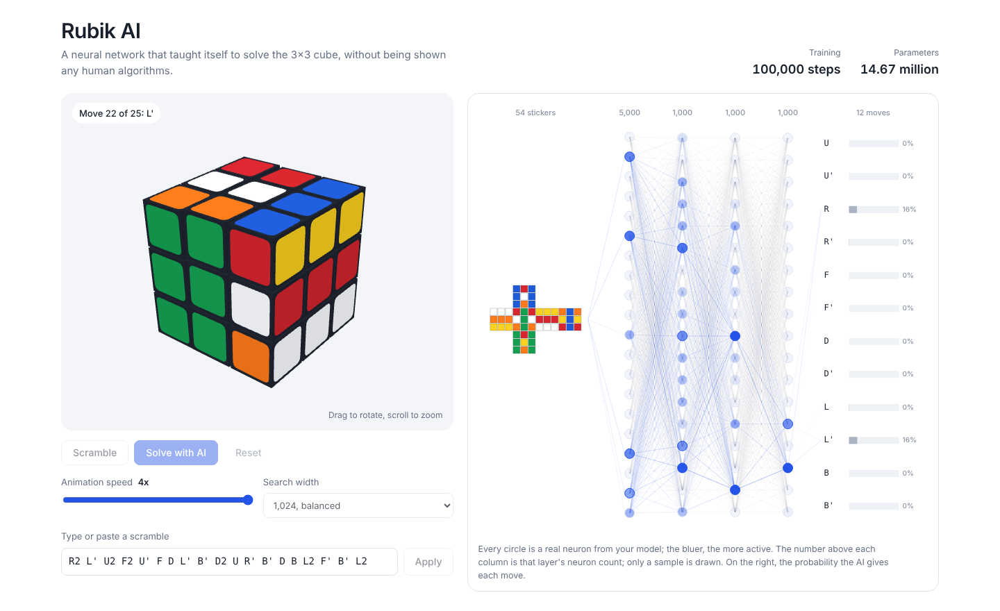
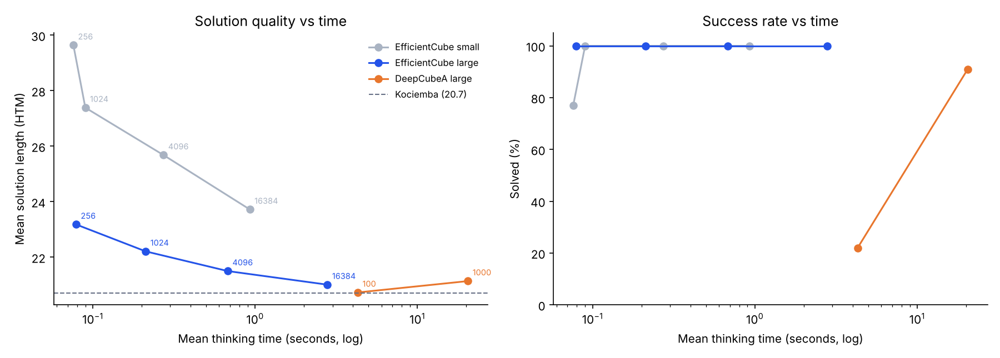

# Rubik AI — Solving the 3x3 Rubik's Cube with Deep Learning

A neural network that teaches itself to solve the Rubik's cube from random scrambles, with no
human algorithms and no external dataset. The best model solves **100 of 100** fully scrambled
cubes with an average of **21.0 moves**, only 0.3 moves above the Kociemba two-phase solver (20.7),
and every solution was also checked on a physical cube.



## Highlights

- **Two learning approaches, re-implemented from the papers:**
  [EfficientCube](https://arxiv.org/abs/2106.03157) (a policy network + beam search) and
  [DeepCubeA](https://deepcube.igb.uci.edu/static/files/SolvingTheRubiksCubeWithDeepReinforcementLearningAndSearch_Final.pdf)
  (a value network trained with Deep Approximate Value Iteration + batch weighted A\*).
- **Cube simulator built from 3D geometry:** move permutations are computed by rotating sticker
  positions, not typed by hand, and cross-checked against Kociemba and a real cube (55 unit tests).
- **Fair experiments:** every result uses the same fixed benchmark of 100 scrambled cubes
  (`benchmarks/benchmark_100.json`, 25 random moves each, seed 2026).
- **Local web app** (FastAPI + Three.js): an animated 3D cube, a live view of the network's real
  neuron activations, the AI's confidence per move, and Kociemba's solution side by side.
- **Trained on a laptop CPU and free cloud GPUs** (Google Colab T4).

## Results

All numbers are averages over the same 100 benchmark cubes. Moves are counted in the half-turn metric (HTM).

| Model | Parameters | Training | Search width | Solved | Mean moves | Mean time |
|---|---|---|---|---|---|---|
| EfficientCube, small | 2.98 M | 20,000 steps, laptop CPU (~3.5 h) | beam 1,024 | 100% | 27.4 | 1.09 s (CPU) |
| EfficientCube, large | 14.7 M | 100,000 steps, Colab T4 (~5 h) | beam 256 | 100% | 23.2 | 0.08 s (GPU) |
| EfficientCube, large | 14.7 M | 100,000 steps, Colab T4 (~5 h) | beam 16,384 | 100% | **21.0** | 2.79 s (GPU) |
| DeepCubeA, large | 14.7 M | 50,000 steps, Colab T4 (~5 h) | A\* batch 1,000 | 91% | 21.1 | 20.5 s (GPU) |
| Kociemba two-phase (baseline) | – | – | – | 100% | 20.7 | 0.014 s (CPU) |



What the experiments showed:

1. **A better model beats a wider search.** The large model with beam 256 (0.08 s) is shorter and
   more reliable than the small model with beam 16,384 (0.93 s on the same GPU).
2. **Diminishing returns from beam width.** Each 4x wider beam costs about 3x more time but only
   shortens solutions by about 2 moves.
3. **With an equal, limited compute budget, EfficientCube is more efficient than DeepCubeA.** At a
   similar solution length, EfficientCube always succeeded and was about 30x faster. This matches
   the EfficientCube paper; DeepCubeA here was trained on far less compute than in its paper.

More charts are in `results/` (`overview.png`, `tradeoff.png` and `length_distribution.png` per
experiment, training curves in `results/colab/`).

## How it works

**Training data (self-supervised).** Start from a solved cube and make random moves. Every state
visited is labeled with the *inverse* of the last move, so the network learns "which move brings
this cube one step closer to solved". Data is generated on the fly with NumPy, so there is no dataset.

**Network.** A one-hot input of 54 stickers x 6 colors (324 values), two dense layers, then
residual blocks. EfficientCube outputs probabilities for the 12 quarter turns; DeepCubeA outputs
one number, the estimated distance to solved.

**Search.** Beam search keeps the `beam` best partial solutions, scored by the sum of the log
probabilities along each path. DeepCubeA uses batch weighted A\* with priority f = 0.6·g + h.

## Project structure

```
Rubik_AI/
├── rubik/                  # Core package
│   ├── moves.py            # Move definitions, permutations computed from 3D geometry
│   ├── cube.py             # Cube class: apply, scramble, is_solved, one-hot, render
│   ├── data.py             # Self-supervised training data generator
│   ├── model.py            # CubeNet (MLP + residual blocks, PyTorch)
│   ├── solver.py           # Neural-network-guided beam search
│   ├── deepcubea.py        # DeepCubeA: DAVI targets + batch weighted A*
│   └── benchmark.py        # Fixed benchmark set shared by all experiments
├── scripts/
│   ├── train.py            # Train EfficientCube (CPU or GPU, resumable)
│   ├── train_deepcubea.py  # Train DeepCubeA
│   ├── beam_experiment.py  # Benchmark run: success rate, length, time per search width
│   ├── compare_results.py  # Compare several runs in one chart
│   ├── evaluate.py         # Quick AI vs Kociemba evaluation
│   ├── export_model.py     # Strip the optimizer, save float16 weights for inference
│   ├── solve_ai.py         # AI solution for a physical cube
│   ├── solve.py            # Kociemba solution for a physical cube
│   └── demo.py             # Simulator demo
├── web/                    # Local web app (FastAPI server + Three.js frontend)
├── notebooks/              # Google Colab notebooks for the large models
├── tests/                  # Unit tests (pytest)
├── benchmarks/             # The fixed 100-cube benchmark set
├── models/                 # Trained models (*.pt)
├── results/                # Experiment results (CSV + charts)
├── run_web.bat             # One-click launcher for the web app (Windows)
└── requirements.txt
```

## Getting started

```bash
python -m venv .venv
.venv\Scripts\activate          # Windows
source .venv/bin/activate       # Linux / macOS

pip install -r requirements.txt
pytest -v                       # run the tests
python -m scripts.demo          # simulator demo
```

If `kociemba` fails to install on Windows (it needs a C compiler), skip it: the simulator still
works and the tests that need Kociemba are skipped.

### Web app

```bash
python -m web.server --model models/cubenet_large_infer.pt
```

The browser opens at http://127.0.0.1:8000. On Windows, double-click `run_web.bat` instead.
The server only listens on 127.0.0.1, so it is reachable from your own machine only.

### Training and evaluation

```bash
python -m scripts.train --steps 2000        # quick test (~10-20 min on a CPU)
python -m scripts.train                     # full training (20,000 steps)
python -m scripts.train --resume            # resume after Ctrl+C
python -m scripts.evaluate                  # AI vs Kociemba
python -m scripts.solve_ai "R U R' U'"      # try it on a physical cube

python -m scripts.beam_experiment --model models/cubenet_large_infer.pt --name my_run
python -m scripts.train_deepcubea --steps 3000
python -m scripts.beam_experiment --model models/deepcubea_large_infer.pt --solver astar --beams 100 1000 --name my_dca_run
```

The large models were trained with `notebooks/train_colab.ipynb` and
`notebooks/train_deepcubea_colab.ipynb` on Google Colab; checkpoints live on Google Drive so
training survives disconnects.

### Notation

- `U R F D L B`: turn that face clockwise (as seen looking at that face)
- `U'`: counter-clockwise, `U2`: half turn
- Hold the cube with white on top and green facing you.

## Limitations

- **Superflip is not solved** with beam 1,024: the position is perfectly symmetric, so the network
  gives almost equal probability (~8%) to every move and the beam search loses direction.
- **Still much slower than Kociemba:** about 0.1-3 s for the best AI versus about 14 ms.
- **DeepCubeA timing is partly an implementation effect:** the A\* search is pure Python with
  per-node data structures, while beam search is almost entirely NumPy.

## Archived: 4x4 experiments

The project was also extended to the 4x4 cube (one-stage AI, reliable up to about 25-move
scrambles, plus a reduction-method experiment with a negative result). Those experiments were
closed to keep the project focused on the 3x3; the code is preserved in the Git tag `arsip-4x4`.

## References

- Takano, K. (2023). Self-supervision is all you need for solving Rubik's cube. *Transactions on
  Machine Learning Research.* [arXiv:2106.03157](https://arxiv.org/abs/2106.03157)
- Agostinelli, F., McAleer, S., Shmakov, A., & Baldi, P. (2019). Solving the Rubik's cube with deep
  reinforcement learning and search. *Nature Machine Intelligence, 1*, 356-363.
- Kociemba, H. Two-phase algorithm (`kociemba` Python package), used as the baseline.

The methods come from the papers above; this project is an independent re-implementation and
comparison on a small compute budget. Much of the code was written with the help of an AI
assistant (Claude, by Anthropic); the author chose the direction, ran all training and experiments,
and validated the solutions on a physical cube.

**Author:** Muhammad Haiqal Ramadhan
